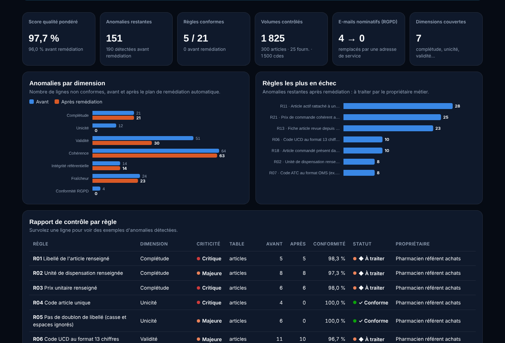

# Contrôle qualité d'un référentiel produits hospitalier

Démarche **Data Steward** complète sur un référentiel fictif de pharmacie hospitalière
(articles, fournisseurs, commandes) :
- **21 règles de contrôle en SQL (DuckDB)** couvrant 7 dimensions de la qualité des données ;
- un **dictionnaire de données** avec propriétaire métier et statut RGPD de chaque colonne ;
- un **plan de remédiation automatique** limité aux corrections sûres ;
- un **rapport par règle et par propriétaire** et une scorecard en ligne.

**👉 [Voir la scorecard en ligne](https://portfolio-fiacre-yehossou.vercel.app/dashboard-qualite-donnees.html)**



> 🔒 **Données 100 % fictives, conformes au RGPD.** Le référentiel est généré par `generate_data.py`
> avec des anomalies injectées volontairement. Aucune donnée patient ni de santé. Les adresses e-mail
> sont inventées (domaine réservé `example.com`). La règle **R15** applique le principe de
> **minimisation** : elle détecte les e-mails nominatifs (`prenom.nom@`) dans le référentiel fournisseurs,
> et la remédiation les remplace par l'adresse de service.

## Problématique métier

Un référentiel produits de mauvaise qualité se paie partout en aval : commandes passées au mauvais
fournisseur, prix incohérents, doublons qui faussent les stocks, indicateurs non fiables.
L'objectif est de **mesurer** la qualité, de **corriger** ce qui peut l'être sans risque et
d'**attribuer** le reste au bon propriétaire métier.

## Les 21 règles

| Dimension | Règles | Exemples |
|---|---|---|
| Complétude | R01, R02, R03, R16 | libellé, unité, prix, pays renseignés |
| Unicité | R04, R05, R17 | code article unique, doublons de libellé (casse/espaces ignorés), raison sociale unique |
| Validité | R06, R07, R08, R09, R14, R19 | code UCD sur 13 chiffres, code ATC au format OMS, prix > 0, unité de la liste de référence, e-mail valide |
| Cohérence | R10, R11, R20, R21 | dates de mise à jour, article actif chez un fournisseur inactif, écart de prix > 20 % |
| Intégrité référentielle | R12, R18 | fournisseur ou article inexistant (orphelins) |
| Fraîcheur | R13 | fiche non revue depuis plus de 24 mois |
| Conformité RGPD | R15 | pas d'e-mail nominatif (minimisation) |

Chaque règle est une requête SQL qui renvoie les lignes non conformes (`sql/regles_qualite.sql`).
Le score est pondéré par la criticité : Critique ×3, Majeure ×2, Mineure ×1.

## Résultats (données fictives)

| | Avant | Après remédiation |
|---|---|---|
| Score qualité pondéré | 96,0 % | **97,7 %** |
| Lignes non conformes | 190 | **151** |
| Règles 100 % conformes | 0 / 21 | **5 / 21** |
| E-mails nominatifs (RGPD) | 4 | **0** |

Les 151 anomalies restantes demandent une **décision métier** (prix manquant, fournisseur inconnu,
code UCD erroné, 28 articles actifs rattachés à deux fournisseurs inactifs...). Elles ne sont pas
corrigées automatiquement : elles sont attribuées au propriétaire de la donnée dans
`rapport/rapport_qualite.csv`.

## Structure du dépôt

```
├── generate_data.py              # référentiel fictif + injection d'anomalies (graine fixe)
├── run_controles.py              # contrôles -> remédiation -> contrôles, rapports et scorecard
├── sql/regles_qualite.sql        # les 21 règles de contrôle
├── sql/remediation.sql           # corrections automatiques sûres
├── data/                         # données brutes (avec anomalies)
├── data_corrigees/               # tables après remédiation
├── rapport/                      # rapport par règle + détail des anomalies avant/après
├── docs/dictionnaire_donnees.csv # dictionnaire de données (source)
├── docs/dictionnaire_donnees.md  # dictionnaire de données (lisible)
└── dashboard/                    # scorecard HTML autonome
```

## Lancer le projet

```bash
pip install -r requirements.txt
python generate_data.py   # régénère le référentiel fictif
python run_controles.py   # contrôles, remédiation, rapports et dashboard/index.html
```

## Compétences mobilisées

Data stewardship et gouvernance des données, SQL (expressions régulières, jointures, fenêtres,
`QUALIFY`), dictionnaire de données, gestion de référentiels (données de référence),
conformité RGPD (minimisation), Python (pandas), restitution aux métiers.

---
Projet réalisé par **Fiacre Yehossou** — Data Analyst | Data Steward | Business Analyst ·
[Portfolio](https://portfolio-fiacre-yehossou.vercel.app/) · [LinkedIn](https://www.linkedin.com/in/fiacre-yehossou)
